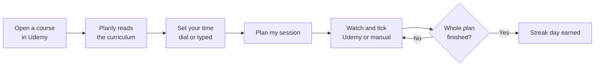
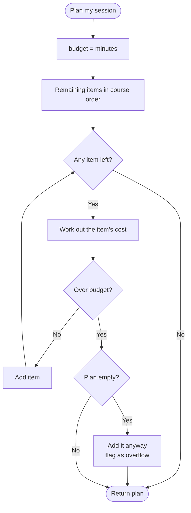
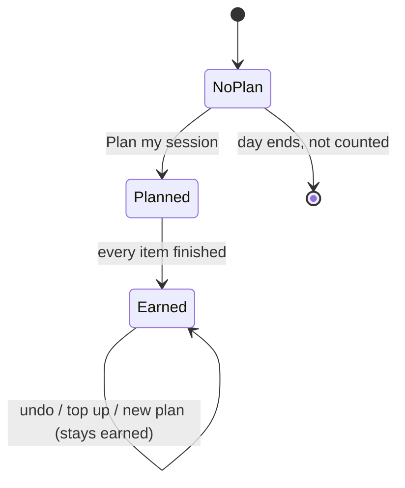
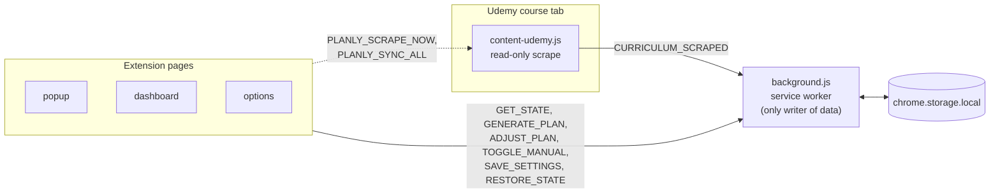

# Udemy Planly

> Tell Planly how much time you have. It picks the **next Udemy lectures that fit completely** in that time, then tracks your streak.

A Chrome extension (Manifest V3) for self-paced Udemy learners. No account, no server, no AI, no network requests. Everything stays in your browser.


---

## Features

| Feature | What it does |
|---|---|
| **Session planner** | Builds today's list from the minutes you give, in course order, never over budget |
| **Auto progress** | Reads Udemy's own completion ticks; you can also tick a lecture manually |
| **Streak** | A day counts when you finish every lecture in that day's plan |
| **Activity heatmap** | Three month tiles shaded by study time, with hover details |
| **Popup + dashboard** | Quick view in the popup; full curriculum tree and stats on the dashboard |
| **Excel backup** | Export and import all data as `.xlsx` |
| **Light / dark theme** | Paper-and-cardboard look, remembered on every page |

---

## How it works



---

## Install

1. Open `chrome://extensions` and turn on **Developer mode**.
2. Click **Load unpacked** and select this folder (or **Reload** if already loaded).
3. **Refresh every open Udemy tab.** Tabs opened before an update keep running the old script.
4. Open a course player, then press **⟳** in the popup (or **Sync all modules** on the dashboard).

## Usage

1. Open a course in the Udemy player so Planly can read it.
2. Set a time with the dial, or type one. It defaults to your daily goal.
3. Press **Plan my session**.
4. Watch. Lectures tick automatically; click a box in the dashboard to mark one manually.
5. Finish the plan to earn the day's streak.

**Accepted time formats**

| You type | Meaning |
|---|---|
| `90` or `90m` | 90 minutes |
| `1.5h` | 90 minutes |
| `1h 30m` | 90 minutes |
| `1:30` | 1 hour 30 minutes |

---

## Planning rules

The planner is a fixed rule, not a model. It takes the remaining items **in course order**, adds them one at a time, and stops the moment the next one would not fit. It never skips ahead and never splits a lecture.



| Item | Time cost |
|---|---|
| Lecture | Length shown by Udemy |
| Lecture with no length | 10 min |
| Quiz or coding exercise | 10 min (fixed) |
| Already finished (Udemy tick or manual) | Skipped |

If you finish some items early, the plan offers **Top up** (drop finished, add more to refill the time), **Remove finished**, or **Keep list**.

## Streak



- A day with no plan does not count, however much you studied.
- A day starts at the **day-start hour** (default 4 AM), in local time.
- The **daily goal** only shades the heatmap and the "today" stat. It does not affect the streak.

**Heatmap shading** (relative to your daily goal)

| Level | Minutes studied | At the default 30 min goal |
|---|---|---|
| 0 | None | 0 |
| 1 | Under half the goal | under 15 |
| 2 | Under the goal | 15 to 29 |
| 3 | Goal met, under double | 30 to 59 |
| 4 | Double the goal or more | 60 or more |

## Settings

| Setting | Options | Default |
|---|---|---|
| Daily goal | 1 to 600 minutes | 30 |
| Day starts at | 12 AM, 3, 4, 5 or 6 AM | 4 AM |
| Sound | On / off | On |
| Dark theme | On / off | Off |

---

## Architecture



**Rules the code follows**

- Only `background.js` writes to storage. Everything else sends messages.
- Scraping is read-only. The only click ever sent to Udemy is the **Sync** button opening collapsed module headers, never inside the video player.
- A partial scrape never shrinks a course: results are merged per module.

**Stored data** (`chrome.storage.local`)

| Key | Holds |
|---|---|
| `courses` | Title, URL and every curriculum item per course |
| `plans` | Manual ticks and one plan per date |
| `settings` | Sound, daily goal, day-start hour |
| `streak` | Count, longest, history, activity, minutes, completed-plan days |

The theme choice is the only value kept in `localStorage`.

## Project structure

```
udemy-planly/
├── manifest.json        Manifest V3
├── background.js        Service worker: state, merge, planner, streak, messages
├── content-udemy.js     Udemy sidebar scraper (read-only)
├── popup/               Compact view
├── dashboard/           Full view, curriculum tree, Excel export/import
├── options/             Settings page
├── shared/              Helpers, theme, dial, streak and heatmap drawing, sound, icons
├── lib/                 SheetJS (bundled)
├── assets/              Flame sprite, fonts
└── docs/                Project documents
```

## Privacy and permissions

| Item | Value |
|---|---|
| Permissions | `storage` only |
| Host access | `https://www.udemy.com/*` |
| Network requests | None |
| Remote code, analytics, accounts | None |
| Data location | Your browser; backup is a file you control |

---

## Known limitations

| Limitation | What to do |
|---|---|
| Scraper was tested on a mock player and one real lecture row, not the live site | If counts look off, inspect a lecture row in DevTools and add its selector at the top of `CANDIDATE_SELECTORS` in `content-udemy.js` |
| Sync needs the sidebar to be visible | Widen the window or leave theatre mode |
| Item IDs are position based | If an instructor inserts a lecture mid-course, later manual ticks may shift |
| Streak resets once when updating to 1.3.8 | Old days have no completed-plan record; only new days count |
| Chrome desktop only | No Firefox or mobile support |

## Version history

| Version | Highlights |
|---|---|
| **1.3.8** | Streak counts finishing the day's plan, not minutes against a goal |
| **1.3.7** | Sharper flame, shared card surface, heatmap uses the accent colour |
| **1.3.6** | Scraper fix for real Udemy markup (durations and ticks) |
| **1.3.5** | Fixed 10 min cost for quizzes and exercises; dial defaults to the daily goal; no network access |
| **1.3.4** | Daily goal, configurable day start, dark theme |
| **1.3.3** | Heatmap tooltips, Top up / Remove / Keep prompt |
| **1.3.2** | Watched-lecture tracking, manual ticks, plan progress |
| **1.3.0 to 1.3.1** | Read-only scraping, all lectures captured per module, local dates |

## Credits and licences

| Asset | Source | Licence |
|---|---|---|
| `lib/xlsx.full.min.js` | SheetJS | Apache-2.0 |
| Icons | Heroicons | MIT |
| Fonts | EB Garamond, Courier Prime | SIL Open Font License (texts in `assets/fonts`) |
| `assets/flame-*.png` | Third-party art | Check the licence before publishing publicly |
